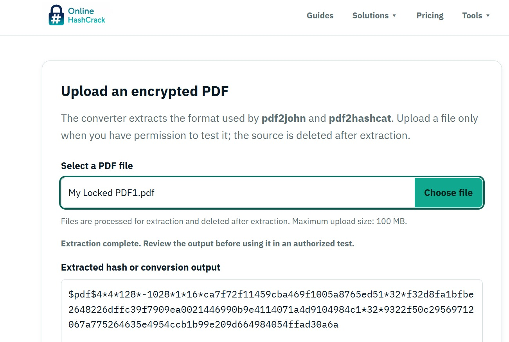
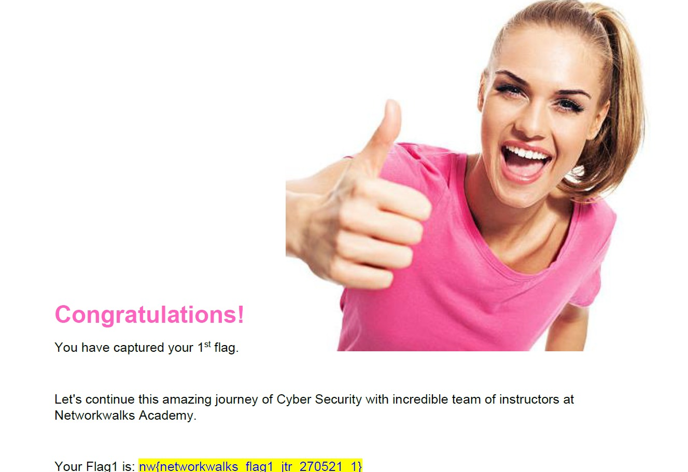

# Week 3 Cybersecurity Internship: Password Cracking

## Project Overview

This project is a cybersecurity internship assignment focused on password cracking concepts and practical password-security exercises. The repository contains screenshots that document the tools, commands, and results observed during the activity, along with the practical use of evidence-based cybersecurity reporting.

## Scope of the Work

The project covers the following areas:

- Password cracking concepts
- Password security and weaknesses
- Practical use of password-cracking tools
- Evidence collection and documentation
- Security reporting and ethical considerations

## Evidence Basis

The repository contains five screenshots that form the main body of evidence for this task. The images show the practical steps and outputs captured during the password-cracking exercise and should be interpreted as documented evidence of the internship activity.

## Repository Structure

- `README.md` — overview and report entry point
- `screen shot 1.jpeg` — first visual evidence
- `Screenshot 2.jpeg` — second visual evidence
- `Screenshot3.jpeg` — third visual evidence
- `screenshot4.jpeg` — fourth visual evidence
- `WhatsApp Image 2026-1-20 at 8.01.45 PM.jpeg` — additional supporting evidence

## Importance of the Work

This assignment demonstrates important cybersecurity concepts through a practical and evidence-based approach. It shows how weak password practices can be assessed, how cracking activity is carried out within an authorized educational environment, and how findings are organized into a structured security record.

## Ethical Considerations

Password-cracking activities must be performed only in an authorized, controlled, and educational environment. Systems and credentials must not be tested without permission. The evidence collected should be handled responsibly, confidential information should be protected, and all testing should follow applicable laws, organizational rules, and professional cybersecurity practices.

## Screenshots

## Conclusion

This repository is best described as an evidence-based cybersecurity learning artifact. It documents a practical password-cracking exercise through screenshots and demonstrates the importance of strong password policies, secure credential handling, and responsible use of security tools.
